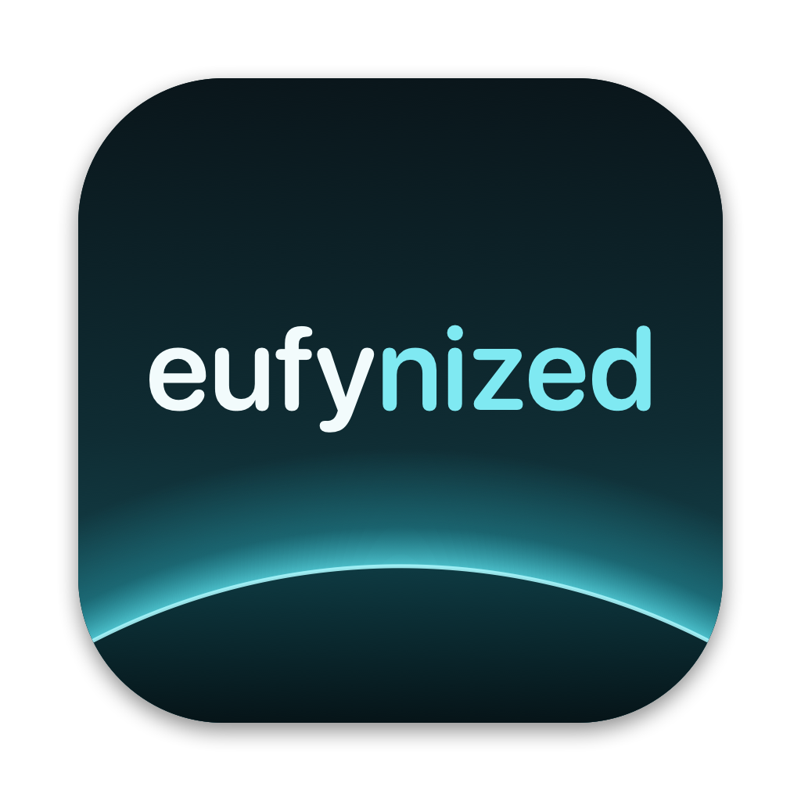

# Eufynized for Mac

Watch and control your eufy cameras from a native Mac app, straight from the HomeBase 3 over your own network.
No eufy cloud in the video path.

This repository has no code. It is the app's home for **bug reports, questions and feature requests**: use the
[Issues](../../issues) tab. The free Home Assistant side (bridge, integration, protocol library) lives at
[rkoh46/eufynized-bridge](https://github.com/rkoh46/eufynized-bridge).

## What it does

- **Live:** every camera up to 4K, Multi-View wall with layouts, zoom, sound, two-way talk, quick replies.
- **Recordings:** a per-day timeline, clips that play from the HomeBase's own drive, save and share, time-lapse.
- **Pan-tilt:** arrows, saved positions with return-to-home, tap-to-aim panorama.
- **Alerts:** notifications with the event's picture, View live / Snooze / False alarm, quiet hours.
- **Settings:** what the eufy app offers these cameras, including Direct power, continuous recording and
  activity zones drawn on the picture. Guard mode and HomeBase storage.
- **Home bridge:** with the free bridge on a Pi, every screen in the house shares one HomeBase session per camera.

Tested with HomeBase 3, eufyCam S3 Pro, eufyCam 2C, SoloCam S340, Indoor Cam E30.

## Requirements

- macOS 14 or later.
- A HomeBase 3 on the same network (or reachable over your own VPN), and a eufy account for the one-time key step.
- The app walks you through setup on first launch: HomeBase address, serial, one eufy sign-in, optional bridge.

## Getting it

Mac App Store: coming. Until then, releases are shared privately.

## Reporting a problem

Open an [issue](../../issues/new/choose). Helpful: the app version (Settings → About), macOS version, camera
model, and what you did right before. Never post your HomeBase key, serial or account details.

## Privacy

Video never leaves your network. The app talks to eufy's cloud once, to fetch the camera key; after that only
to your HomeBase. No analytics.

## Disclaimer

Not affiliated with Anker or eufy. "eufy" is a trademark of Anker Innovations.
